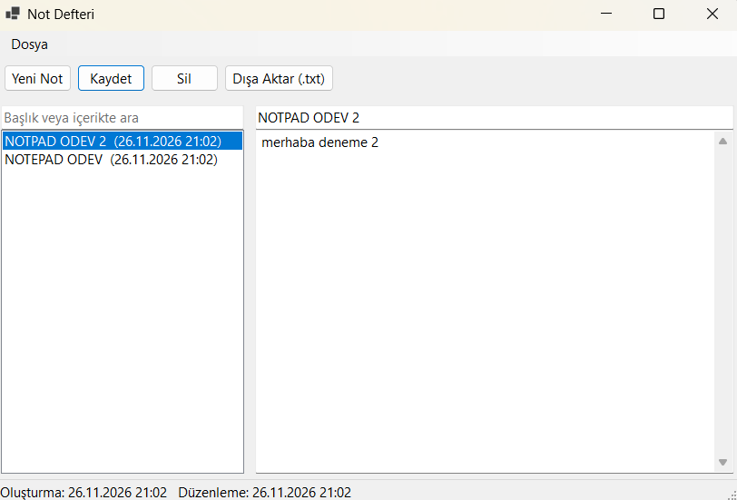
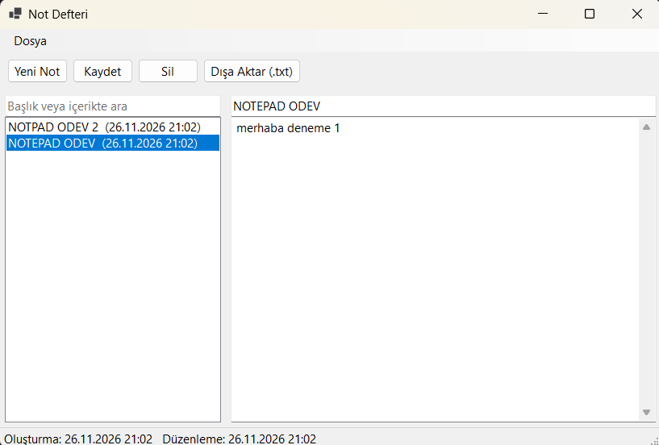

# YMH219 - Not Defteri

Nesne Tabanlı Programlama (YMH 219) dersi için notları bilgisayarda kalıcı olarak saklayan Windows Forms uygulaması. Odak: dosya işlemleri ve serileştirme.

**Öğrenci:** Muhammed Metin Kızıl
**Öğrenci No:** 250541038

## Kullanılan Teknolojiler

- C# / .NET 8, Windows Forms
- `System.Text.Json` ile serileştirme
- `System.IO` (`File`, `StreamWriter`)
- Ek NuGet paketi kullanılmamıştır

## Kurulum ve Çalıştırma

Gereksinim: Windows ve .NET 8 SDK (veya Visual Studio 2022).

```bash
dotnet run
```

## Temel Özellikler

- Başlık ve içerikten oluşan notları ekleme, listeleme, düzenleme, silme
- Notları JSON dosyasına kaydetme ve açılışta otomatik yükleme
- Her notta oluşturma ve düzenleme tarihi
- Notu `.txt` olarak dışa aktarma
- Başlığa veya içeriğe göre arama
- Menü ve kısayollar: Ctrl+N, Ctrl+S, Ctrl+E, F5
- Kaydedilmemiş değişiklik uyarısı
- Bozuk dosyada yedek alma; okunamayan dosyanın üzerine yazmama

## Verinin Saklandığı Yer

`%LocalAppData%\YMH219-NotepadApp\notlar.json`

## Sınıf Yapısı

| Sınıf | Görevi |
|---|---|
| `Not` | Tek bir notun verisi |
| `NotDeposu` | `List<Not>`, yükleme, kaydetme, arama, dışa aktarma |
| `NotepadForm` | Arayüz ve kullanıcı etkileşimi |

## Ekran Görüntüleri

**Not listesi ve açık not**



**Başka bir not seçiliyken**



## Bilinen Sınırlamalar

- Notlar şifrelenmez; parola gibi bilgiler yazılmamalıdır.
- Düz metin desteklenir; biçimlendirme, kategori ve etiket yoktur.
- Uygulama aynı anda iki kez açılırsa son kaydeden diğerinin değişikliklerini ezer.
